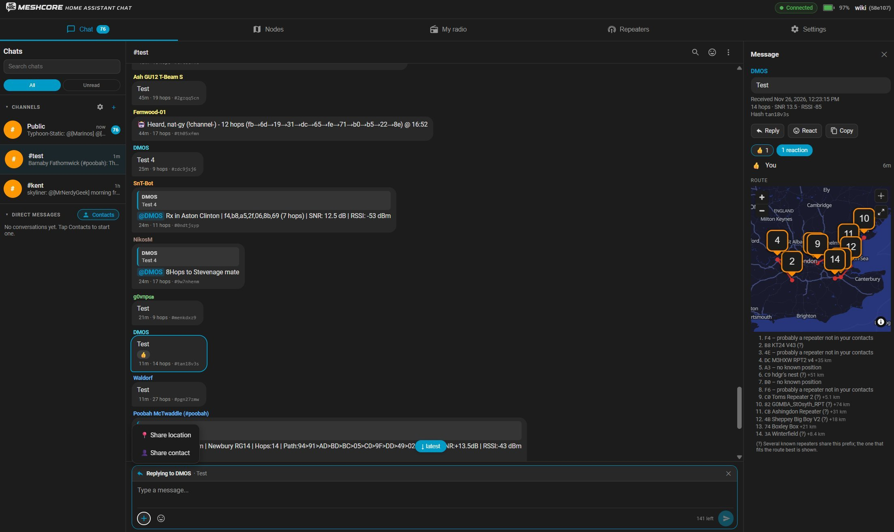
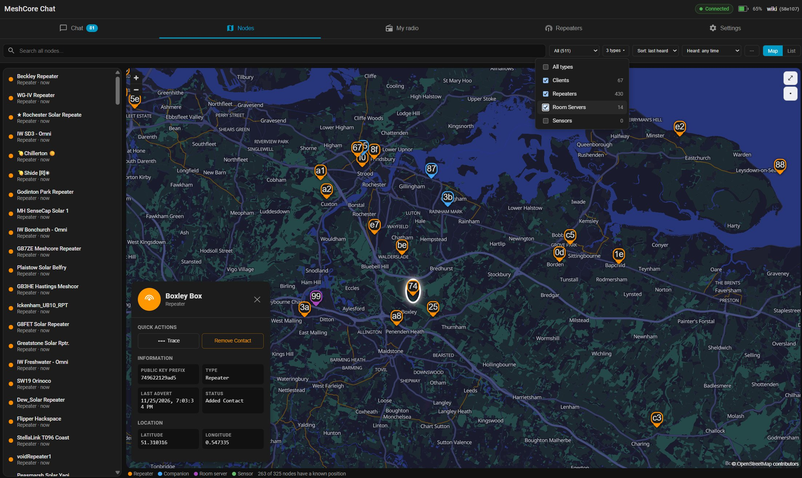
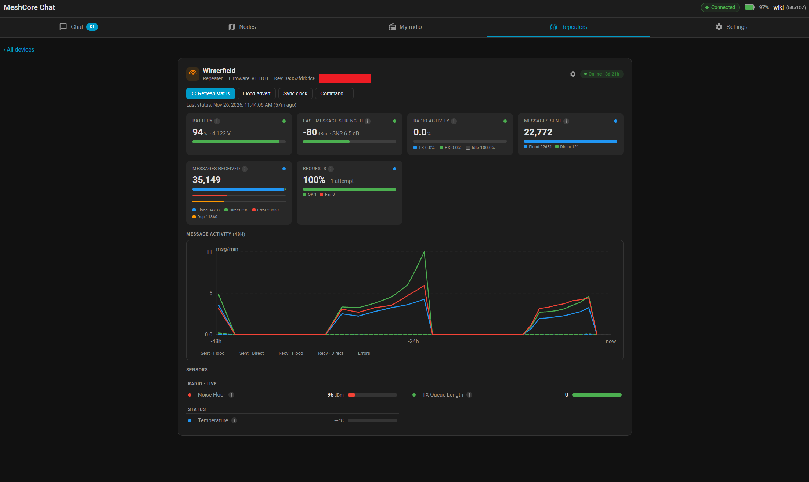
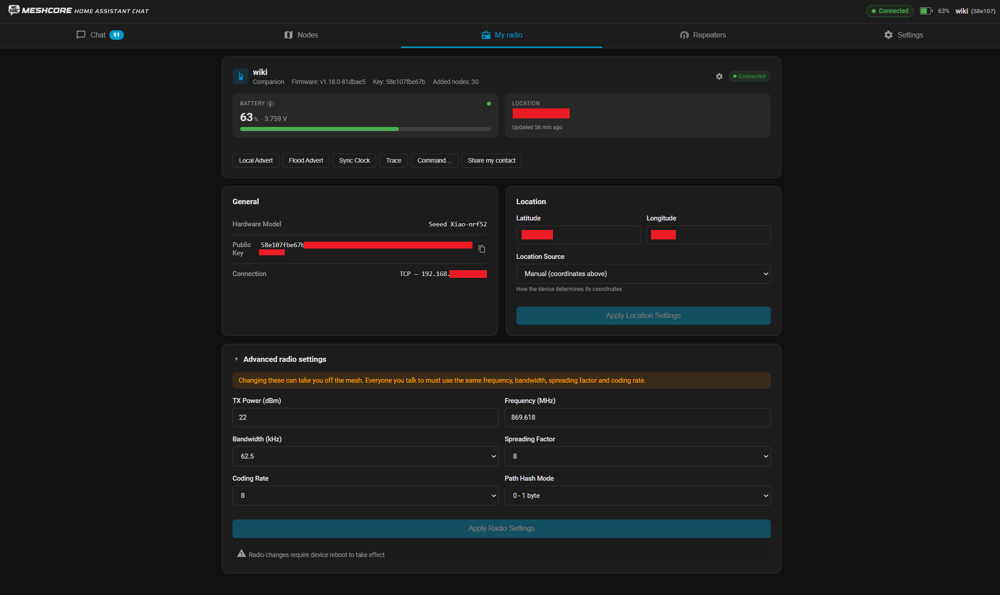
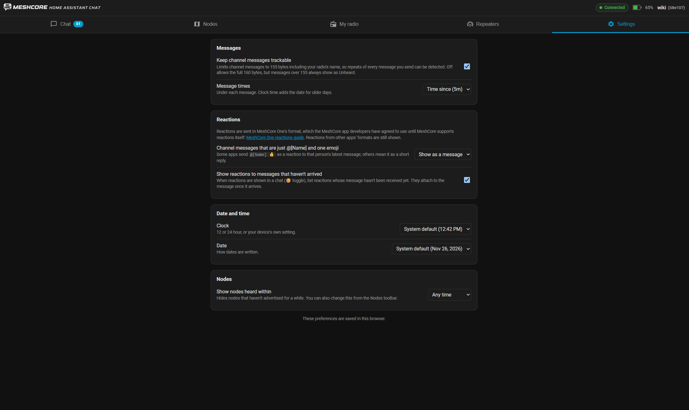
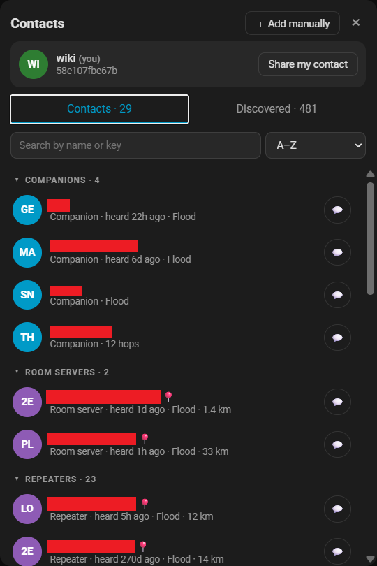
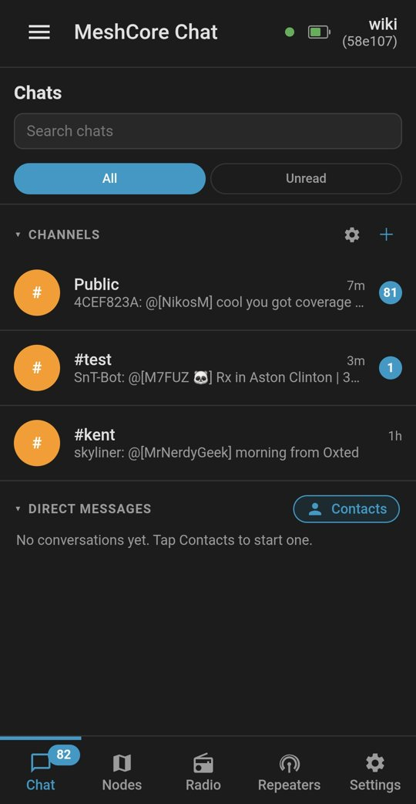
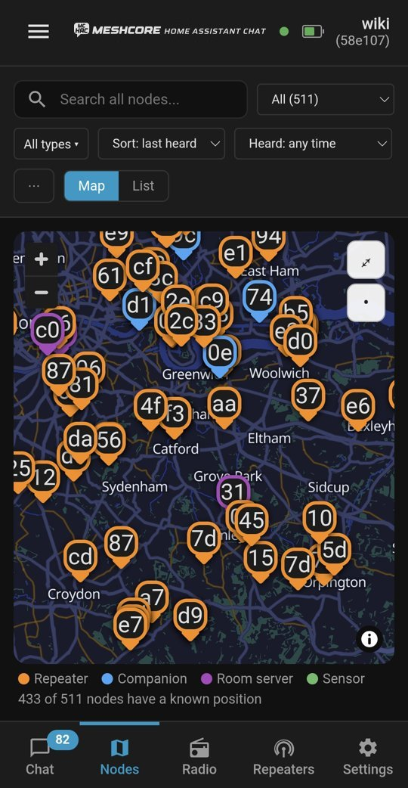

<p align="center"></p>

# MeshCore Chat for Home Assistant

A chat panel for the [MeshCore](https://meshcore.io) mesh radio network, right in your Home Assistant sidebar. Channels and direct messages, a live node map, contacts, repeater management and your radio's settings, all in one place, with message history that survives restarts.

It works alongside the [core MeshCore integration](https://github.com/meshcore-dev/meshcore-ha), which talks to the radio. Install both.

> **This is a fork** of [MeshCore Chat](https://github.com/mwolter805/meshcore-ha-chat) by Matt Wolter, maintained by [kohkohwastaken](https://github.com/kohkohwastaken). Route matching is ported from [MeshCore Chattx](https://github.com/michalsiman/meshcore-ha-chattx) by Michal Šiman. Both are MIT-licensed. See the [changelog](CHANGELOG.md) for everything that's changed, and report issues for this fork [here](https://github.com/kohkohwastaken/meshcore-ha-chat/issues).

<p align="center"><a href="https://raw.githubusercontent.com/kohkohwastaken/meshcore-ha-chat/main/assets/screenshots/chat.jpg"></a></p>

## What's in it

The panel has five tabs. On a phone they move to a bar along the bottom.

### 💬 Chat

- **Channels, rooms and direct messages** in sections you can collapse, each showing the last message and how long ago it was. Empty DMs are hidden.
- **Reactions** that work with other apps: we send and read the [MeshCore One reaction format](https://github.com/Avi0n/MeshCoreOne/blob/main/docs/Reactions.md), which the community has settled on until MeshCore supports reactions itself. We also read reactions from MeshCore Open and plain `@[Name] 👍` messages. Any emoji works. A toggle in the chat header shows or hides the raw reaction messages.
- **Replies** with a quote of the message being answered, when it's clear which one that is. You can only reply to someone's newest message, so replies never point at the wrong one.
- **Message details**: hops, SNR, RSSI, the route on a map, the exact time, and each message's hash (shown next to the hop count).
- **Delete** a single message or a whole conversation, with a confirmation first.
- **Rooms** (room servers): opening one logs you in and catches you up on posts you missed, showing who wrote each post. Nothing is sent in the background: use ⟳ Check for new posts when you want an update. The panel warns you if you're read-only or if the room has stopped sending to you.
- **Search** within a conversation, unread counts, and delivery status (Sent, Repeated, Waiting) with Resend.

### 👥 Contacts

Opened from the **Contacts** button next to Direct messages.

- **Contacts** grouped into Companions, Room servers, Repeaters and Sensors, and **Discovered** nodes your radio has heard. Discovered loads 500 at a time as you scroll. Sort A–Z, Z–A, newest or oldest heard.
- **Add manually** by pasting a chat code, a `meshcore://` link, a QR code's text, or a bare public key. Contacts added this way show as **Unverified** until your radio hears from them (an advert or a direct message).
- **Share my contact** as a QR code (copy or save the image), a chat code, or a link, or send it to nearby radios over the air. You can share other contacts the same way.

### 🗺️ Nodes

- **Map or list** of every node your radio knows, on Home Assistant's own map. Tap a pin to see its details beside the map. The selected pin is highlighted.
- **Filter** by Added/Discovered, by any mix of types, and by when they were last heard (24 hours, 7 days, 30 days, 1 year, or since a date you pick).
- **Clear stale nodes**: remove nodes not heard for as many days as you choose, picking the types and whether to include discovered nodes, unverified manual contacts, or both. It tells you how many will go before you confirm.
- **Trace** a path through chosen repeaters, or discover one, and see it on the map.

### 📻 My radio

Your companion radio's profile, battery and signal, location, and radio settings (TX power, frequency, bandwidth, spreading factor, coding rate, path hash mode). Rename, key management and commands are in the ⚙ menu.

### 📡 Repeaters

One card per repeater or client you manage, showing its status and when it was last heard. Open a card for its sensor tiles, neighbour table and quick actions. **Refresh status** logs in and asks for fresh stats, and the card shows when the last status arrived. Click any tile for its full history.

### ⚙️ Settings

Saved per browser: message display, reaction preferences, date and time format, and which nodes to show by default.

## Screenshots

<table>
<tr>
<td width="50%"><a href="https://raw.githubusercontent.com/kohkohwastaken/meshcore-ha-chat/main/assets/screenshots/nodes-map.jpg"></a></td>
<td width="50%"><a href="https://raw.githubusercontent.com/kohkohwastaken/meshcore-ha-chat/main/assets/screenshots/repeater.png"></a></td>
</tr>
<tr>
<td><b>Nodes</b>: every node on the map, filtered by type, with the selected node's details beside it.</td>
<td><b>Repeaters</b>: live status, message activity and Refresh status for a managed repeater.</td>
</tr>
<tr>
<td><a href="https://raw.githubusercontent.com/kohkohwastaken/meshcore-ha-chat/main/assets/screenshots/my-radio.png"></a></td>
<td><a href="https://raw.githubusercontent.com/kohkohwastaken/meshcore-ha-chat/main/assets/screenshots/settings.png"></a></td>
</tr>
<tr>
<td><b>My radio</b>: your companion's battery, location, quick actions and radio settings.</td>
<td><b>Settings</b>: message, reaction, date and node preferences, saved per browser.</td>
</tr>
<tr>
<td colspan="2" align="center"><br><b>Contacts</b>: grouped contacts, discovered nodes, Add manually and Share my contact.</td>
</tr>
<tr>
<td colspan="2" align="center"> &nbsp; <br><b>On a phone</b>: the tabs move to a bar along the bottom.</td>
</tr>
</table>

## Installation

### HACS

[](https://my.home-assistant.io/redirect/hacs_repository/?owner=kohkohwastaken&repository=meshcore-ha-chat&category=integration)

Click the badge, or add it by hand:

1. HACS → ⋮ → **Custom repositories**
2. Add `https://github.com/kohkohwastaken/meshcore-ha-chat` as an **Integration**
3. Install **MeshCore Chat** and restart Home Assistant
4. Settings → Devices & Services → **Add Integration** → **MeshCore Chat**

To try a beta, turn on **Show beta versions** in HACS, or pick a version from the **Redownload** dropdown.

### Manual

Copy `custom_components/meshcore_chat/` into your Home Assistant `config/custom_components/` folder, restart, and add the integration from the UI.

## Requirements

- Home Assistant **2025.6.0** or newer
- The core [MeshCore integration](https://github.com/meshcore-dev/meshcore-ha) **2.7.0** or newer, installed and set up with your radio

## Usage

For walkthroughs of common tasks and things worth knowing (radio reboots, renaming entities), see [INSTRUCTIONS.md](./INSTRUCTIONS.md).

> **Permissions.** Any Home Assistant user can read messages and use the panel. Changing radio settings, keys or channels, issuing commands, adding or removing contacts, clearing nodes and running traces need an **administrator**.

## Known limitations

- **Message history isn't a permanent log.** By default it keeps 90 days and up to 500 messages per conversation. Change this in Settings → Devices & Services → MeshCore Chat → Configure.
- **Reactions and replies aren't part of MeshCore itself.** They're text conventions between apps, so an app that doesn't know them shows them as ordinary messages.
- **Discover traces don't always come back** on long routes. If one fails, pick the repeaters yourself or enter the path.

## Security

Report security issues privately; see [SECURITY.md](SECURITY.md). For how the integration treats data from the mesh, see [docs/security-posture.md](docs/security-posture.md).

## Removal

To uninstall:

1. Settings → Devices & Services → MeshCore Chat → ⋮ → Delete.
2. Optional: remove the message archive from disk:
   ```bash
   rm /config/.storage/meshcore_chat.*
   ```
   The archive is per-entry; deleting the config entry does not remove these files automatically (HA's standard behaviour). Skip this step if you intend to re-add the integration later — the archive will be re-attached.
3. If you also want to uninstall the underlying meshcore integration: Settings → Devices & Services → MeshCore → Delete, then remove `custom_components/meshcore` (HACS or manual).

## Development

Contributions and bug reports welcome — file issues at [github.com/kohkohwastaken/meshcore-ha-chat/issues](https://github.com/kohkohwastaken/meshcore-ha-chat/issues).

### Repo layout

- `custom_components/meshcore_chat/` — the Home Assistant integration (Python).
- `frontend/` — the Lit-based sidebar panel (TypeScript). Rolled up into a single bundle that lands at `custom_components/meshcore_chat/meshcore-chat-panel.js`.
- `tests/` — Python test suite (pytest + `pytest-homeassistant-custom-component`).
- `frontend/tests/` — frontend unit tests (vitest).

### Python tests

The integration targets the Python version shipped in the current HA OS / Docker image (3.14 as of HA 2025.x). Set up a local venv:

```bash
cd meshcore-ha-chat
uv venv --python 3.14 .venv
.venv/bin/pip install pytest-homeassistant-custom-component
```

`pytest-homeassistant-custom-component` (PHACC) transitively pulls in Home Assistant core, pytest, pytest-asyncio, and the full HA test fixture surface — no other install steps are needed. The integration is **not** installed as a package; `tests/conftest.py` puts the repo root on `sys.path` so `custom_components.meshcore_chat.*` is importable directly.

Run the suite:

```bash
.venv/bin/pytest tests/                    # full suite (~1s)
.venv/bin/pytest tests/components/meshcore_chat/test_ws_api.py -k identity
```

> **Do not** `pip install -e .[test]` (or any pip install) inside a running Home Assistant Docker container. The editable-install metadata persists across `pip uninstall` and crashes HA on the next restart with `FileNotFoundError` from `async_get_custom_components`. Always use a separate venv.

### Frontend

```bash
cd frontend
npm install
npm run build       # production bundle (minified)
npm run dev         # rollup watch mode
npm test            # vitest, run once
npm run test:watch  # vitest in watch mode
```

The build writes straight to `../custom_components/meshcore_chat/meshcore-chat-panel.js`. Committing the rebuilt bundle does not deploy it — for that, see below.

### Deploying a dev build to a live HA host

After `npm run build`, copy the rebuilt panel bundle to your HA host:

```bash
scp custom_components/meshcore_chat/meshcore-chat-panel.js \
    root@<ha-host>:/config/custom_components/meshcore_chat/
```

Then **hard-refresh** the panel in the browser (Cmd/Ctrl-Shift-R). No Home Assistant restart is needed for frontend-only changes — the panel is reloaded from disk on browser refresh.

For Python-side changes (anything under `custom_components/meshcore_chat/*.py`), SCP the changed files and reload the integration: **Settings → Devices & Services → MeshCore Chat → ⋮ → Reload**, or restart HA if the change touches `__init__.py`, the config-flow, or anything wired at setup time.

## Tips & Troubleshooting

The integration should be fairly easy to understand and navigate, for instructions on dialog pop-ups and operational gotchas worth knowing, see [INSTRUCTIONS.md](./INSTRUCTIONS.md).

## License

MIT — see [LICENSE](LICENSE).
