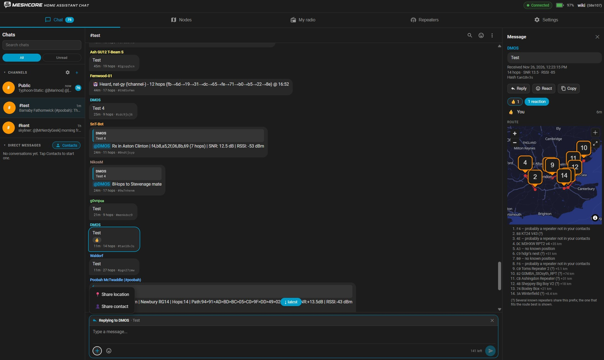

# MeshCore Chat

A chat panel for the MeshCore mesh radio network in your Home Assistant sidebar: channels and direct messages, a node map, contacts, repeater management and your radio's settings, with message history that survives restarts.

Works alongside the [core MeshCore integration](https://github.com/meshcore-dev/meshcore-ha), which talks to the radio. Install both.

- Channels and DMs with reactions (MeshCore One format), replies, message hashes and delete
- Contacts: add manually, share as QR code, chat code or link, Unverified badge
- Nodes on Home Assistant's map with type and last-heard filters, stale-node cleanup and traces
- Repeater status, sensors and commands; your radio's settings
- Works on phones, with a bottom tab bar

**Requires:** Home Assistant 2025.6+ and the core MeshCore integration 2.7.0+.
